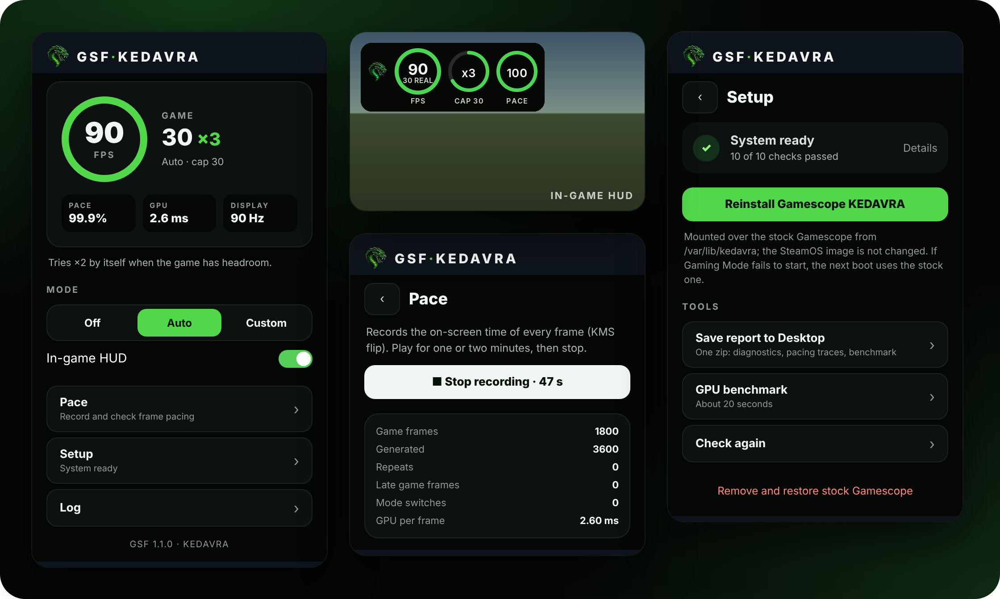
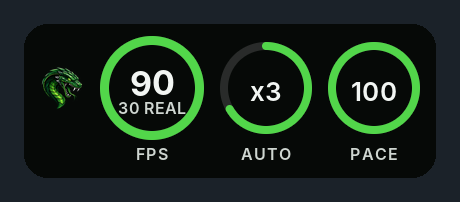

<div align="center">

[English](README.md) · **Русский**


# GSF Kedavra

**Собственная генерация кадров x2 / x3 для Steam Deck в игровом режиме. Без Lossless Scaling. Без команд запуска.**

GSF (GPU Synthetic Frames) создаёт промежуточные кадры внутри пропатченного Gamescope, то есть в том композиторе, который на Deck и так управляет каждым vblank и каждым переключением кадра. Плагин Decky устанавливает его, включает, выключает и измеряет результат.

[**Скачать 1.1.0**](https://github.com/wavessevaw/GSF/releases/tag/v1.1.0) · [Установка](#установка) · [Режимы](#режимы) · [Измерение темпа](#измерение-темпа) · [Как это работает](#как-это-работает)

[](https://github.com/wavessevaw/GSF/releases/latest)
[](https://www.steamdeck.com/)
[](https://decky.xyz/)
[](#известные-ограничения)
[](LICENSE.md)



<sub>Собственный код интерфейса и HUD плагина, отрисованный с примерными значениями. Это не измерение.</sub>

</div>

> **Статус: экспериментально.** Движок, планировщик и плагин проходят программные тесты в CI, сборка работает на Steam Deck OLED. Цели по темпу ниже для 1.1.0 **ещё не подтверждены трассой KMS flip на железе**. Прошлые сборки, измеренные на Deck, их не выполняли: [данные с Deck](docs/kedavra/evidence/deck-20261021/README.md).

## Почему GSF Kedavra

- **Без Lossless Scaling.** Ни платной программы, ни DLL из чужого приложения, ни Vulkan-слоя внутри игры. У GSF свой движок интерполяции (GPL-3.0).
- **Работает в любой игре, которую показывает Gamescope.** Кадры берутся из композитора: ничего не нужно внедрять, параметры запуска для каждой игры не нужны.
- **Один zip, ничего вручную.** Плагин Decky сам ставит и обновляет свою сборку Gamescope, проверяет систему и сам откатывает изменения. Никаких скриптов в режиме рабочего стола.
- **Системный образ не меняется.** Gamescope KEDAVRA лежит в `/var/lib/kedavra` и подключается поверх стокового, только пока работает служба. Если загрузка не дошла до игрового режима, следующая загрузка вернёт стоковый Gamescope.
- **Темп кадров на первом месте.** Планировщик по vblank решает, что показать на каждом обновлении экрана, а игра держится на ровной частоте, которую генерация заполняет равномерно.
- **Лимит FPS вручную не нужен.** В режиме **Auto** движок сам ограничивает игру и выбирает x2 или x3 по тому, что игра реально выдаёт. Или задайте свой базовый FPS одним ползунком.
- **Честные цифры.** Кольцо считает новые кадры на экране и собственные кадры игры, а запись темпа берётся из меток KMS page flip, а не из счётчика FPS.

## Установка

Нужен [Decky Loader](https://decky.xyz/). Проверено на SteamOS 3.8. Интерфейс плагина на английском, ниже названия кнопок даны как в плагине.

1. Скачайте [**GSF-Kedavra-1.1.0.zip**](https://github.com/wavessevaw/GSF/releases/download/v1.1.0/GSF-Kedavra-1.1.0.zip).
2. В Decky: **Настройки → Разработчик → Установить плагин из zip**, выберите файл. Установка поверх старого плагина KEDAVRA сохраняет настройки.
3. Откройте плагин, раздел **Setup**, нажмите **Установить Gamescope KEDAVRA**. Перезагрузите Deck, когда плагин попросит.
4. После перезагрузки все проверки в разделе **Setup** зелёные и нет строки о том, что установленный Gamescope отличается от того, что в плагине.

Удалить: **Remove and restore stock Gamescope** в разделе **Setup**, затем перезагрузка.

## Режимы

| Режим | Что делает |
| --- | --- |
| **Off** | Игра идёт без изменений. Кольцо показывает собственный FPS игры. |
| **Auto** | Движок ограничивает игру до 30 FPS (x3) или 45 FPS (x2) при 90 Гц. Начинает с x3, после ровного отрезка пробует x2 и сразу возвращается на x3, если игра не держит 45. |
| **Custom** | Движок держит игру на заданном базовом FPS (от 20 до 90), генерация заполняет остальную частоту экрана. Ровнее всего значения, на которые делится частота (30 и 45 при 90 Гц). Другие, например 40, работают с шагом 2-2-3. |

**Для самого стабильного результата включите лок FPS в настройках самой игры** (30 или 45) и выберите то же значение в **Custom**. Игра, которая сама выдерживает свои кадры, даёт генератору равномерный вход. Лимит FPS в Steam не нужен: пока генерация включена, GSF ставит лимит сам и возвращает лимит Steam, когда она выключена.

Генерации нужно несколько миллисекунд GPU на каждый кадр игры для анализа движения. Если игра уже занимает весь GPU, снизьте базовый FPS.

## HUD в игре



HUD по желанию рисует поверх игры три кольца, в стиле [GFG Extreme](https://github.com/wavessevaw/GFG-Extreme):

- **FPS:** сколько новых кадров (реальных и сгенерированных) выходит на экран в секунду. Под ним **REAL**: собственный FPS игры. Повторы кадров и перерисовки меню Steam не считаются.
- **x2 / x3:** текущий множитель. Дуга показывает долю сгенерированных кадров. Подпись: **AUTO** или **CAP** с базовым FPS.
- **PACE:** доля обновлений экрана, на которых появился новый кадр. Зелёный выше 99,5%.

## Измерение темпа

**Pace → Record pacing trace** пишет время KMS flip на каждом обновлении экрана, пока вы играете. Остановите запись через одну-две минуты, и плагин разберёт трассу прямо на Deck. Цели 1.1.0:

| Метрика | Цель |
| --- | --- |
| P95 ошибки интервала | ≤ 1 мс |
| P99 ошибки интервала | ≤ 2 мс |
| Пропущенные обновления | < 0,5% |
| Колебания, рост задержки | нет |

Если что-то не так, нажмите **Setup → Save report to Desktop**: на рабочем столе появится один zip (`~/Desktop/GSF-report-….zip`) с диагностикой, последними трассами темпа и бенчмарком. Пришлите его.

## Как это работает

1. Gamescope копирует каждый новый кадр игры в небольшое кольцо на GPU.
2. Сразу после композиции кадра отдельная отправка запускает иерархическую оценку движения между ним и предыдущим кадром. Она разбита на два обновления экрана, чтобы никогда не задерживать переключение кадра.
3. На каждом vblank планировщик (`kedavra/sched/kfg_sched.h`) выбирает реальный кадр или промежуточный в нужной фазе. Кадры игры, у которой момент вывода дрожит около лимита, остаются на сетке лимита, поэтому движение остаётся равномерным.
4. Промежуточный кадр собирается в полном разрешении с учётом перекрытий, и Gamescope выводит его как любой другой кадр.
5. Плагин раз в секунду читает статус движка, рисует HUD и пишет трассы.

Подробнее: [архитектура](docs/kedavra/PHASE_B_ARCHITECTURE.md), [протокол проверки на Deck](docs/kedavra/DECK_PROTOCOL.md), [исходники движка и планировщика](kedavra/README.md).

## Известные ограничения

- Только SDR. Игры в HDR проходят без генерации.
- Собрано и проверялось для Steam Deck OLED на 90 Гц. Другие частоты работают в модели и тестах, но на железе не измерялись.
- Мелкие повторяющиеся детали (лестницы, заборы, решётки) самый трудный случай для любой оценки движения. В 1.0.0 мерцание от них уменьшено, а 1.1.0 лучше следит за ходьбой вперёд и по лестнице, но мелкие ступени при низком базовом FPS ещё могут рассыпаться.

## Сборка из исходников

```sh
make -C kedavra test                 # тесты планировщика, стресс-матрица модели, движок на Vulkan (подходит lavapipe)
make -C kedavra bench                # время GPU движка (имеет смысл на Deck)
sh kedavra/decky/package.sh out.zip  # zip плагина без среды Gamescope
```

Полный плагин со средой Gamescope собирает [CI](.github/workflows/kedavra.yml) на Gamescope `aa289ea`.

## Репозиторий

- [`kedavra/`](kedavra/): текущий движок, планировщик, интеграция с Gamescope и плагин Decky.
- [`engine/`](engine/), [`decky/`](decky/), [`docs/fg3/`](docs/fg3/), [`docs/archive/`](docs/archive/README.md): прошлые исследования GSF (прототипы Vulkan-слоя, Temporal Engine, аудиты), сохранены для истории.
- GSF из одного семейства с [GFG Extreme](https://github.com/wavessevaw/GFG-Extreme). Как код был выделен, описано в [MIGRATION.md](MIGRATION.md).

## Лицензия

**GPL-3.0-or-later**, с сохранёнными авторскими правами и уведомлениями сторонних проектов: [лицензия](LICENSE.md), [авторские права](COPYRIGHT.md), [сторонние компоненты](NOTICE.md), [пояснения к лицензии](docs/LICENSING.ru.md). GPL не даёт права выдавать изменённые сборки за официальные релизы GSF: [правила использования названия](TRADEMARKS.md). Участие в разработке: [CONTRIBUTING.md](CONTRIBUTING.md).
